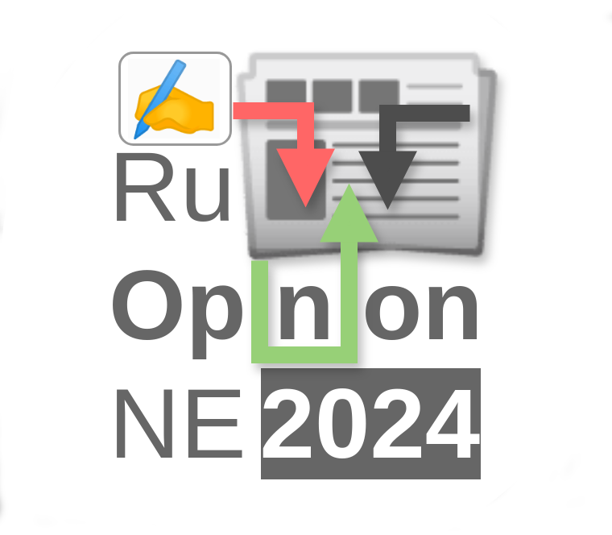
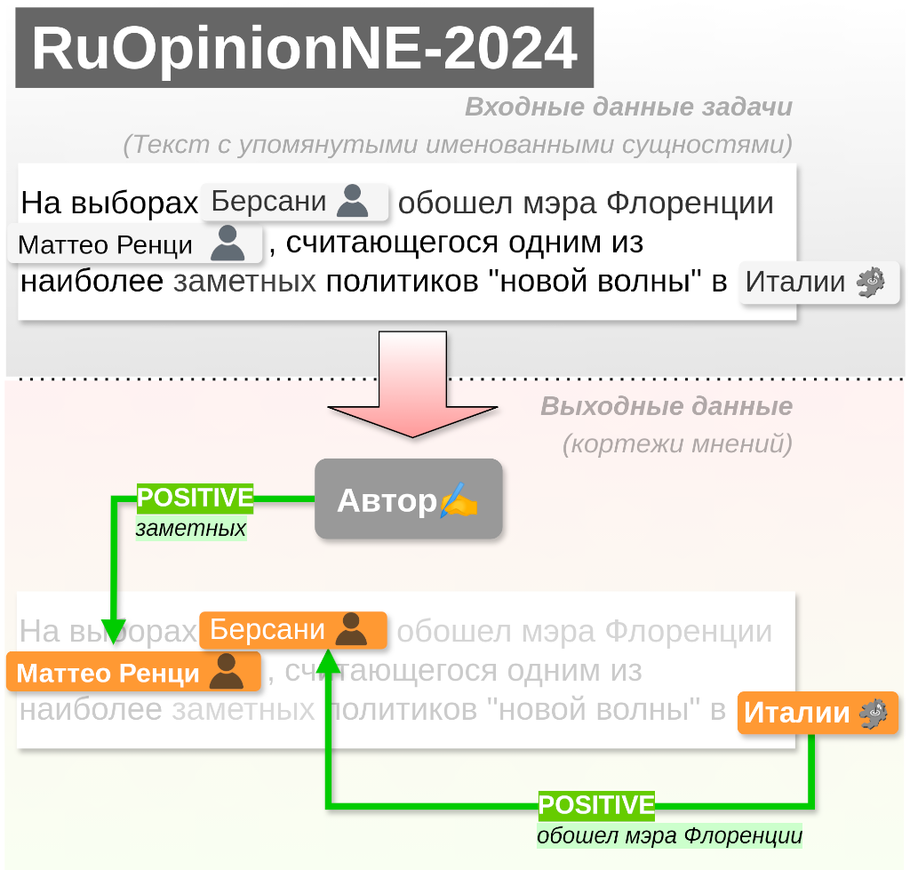

# RuOpinionNE-2024 -- соревнование по извлечению кортежей мнений из русскоязычных новостных текстов
[](https://t.me/RuOpinionNE2024) 
[](https://x.com/nicolayr_/status/1846614551749337521)
[](https://arxiv.org/abs/2504.06947)

<p align="center">
    <a href="https://www.codabench.org/competitions/18622"></a>
</p>

> :book: **16 ноября 2026:** переход на codabench хостинг в связи с закрытием codalab платформы. Соревнования доступны https://www.codabench.org/competitions/18622. История посылок доступна на [legacy codalab](https://codalab.lisn.upsaclay.fr/competitions/20244)

> :book: **10 мая 2025:** [опубликована pre-print версия статьи на arXiv](https://arxiv.org/abs/2504.06947) по результатам основного (`final`) этапа соревнований

### [Ссылка на соревнования в системе CodaBench](https://www.codabench.org/competitions/18622)

### ~~[Ссылка на соревнования в системе Codalab](https://codalab.lisn.upsaclay.fr/competitions/20244)~~

### [:alarm_clock: Даты и график проведения соревнования](https://codalab.lisn.upsaclay.fr/competitions/20244#learn_the_details-terms_and_conditions)

### [:chart_with_upwards_trend:  Таблица результатов](https://codalab.lisn.upsaclay.fr/competitions/20244#results)

### [:newspaper: Telegram канал соревнований](https://t.me/RuOpinionNE2024)

# Содержание

* [Краткое описание](#краткое-описание)
   * [**Кортеж мнения**](#кортеж-мнения)
   * [Пример](#пример)
* [Формат данных](#формат-данных)
    * [Пример чтения данных](#пример-чтения-данных)
* [Соревнования на Codalab](#соревнования-на-codalab)
    * [Базовый подход](#базовый-подход)
* [Организаторы](#организаторы)
* [Источники](#источники)
* [Ссылки](#ссылки)

# Краткое описание 
[](https://arxiv.org/abs/2504.06947)

> ⚠️ **Внимание:** Полное описание представлено **[на платформе Codalab](https://codalab.lisn.upsaclay.fr/competitions/20244#learn_the_details-overview)**. 
> Настоящее описание несет ознакомительный характер.

**RuOpinionNE-2024** является продолжением тестирования [RuSentNE-2023](https://www.dialog-21.ru/evaluation/2023/rusentne/), 
в котором требовалось извлечение *тональности предложения по отношению к заданной именованной сущности*. 
Ключевые отличительные особенности постановки настоящей задачи приведены в формате указания *входной* и *выходной* информации.

<p align="center">
    
</p>

> **Рисунок**: пример извлечения кортежей мнений соревнования RuOpinionNE-2024; 
> сущности входного текста **не являются параметрами задачи**, а лишь размечены визуально.

**Входная информация** включают в себя текст представляющий собой предложение из новостного текста с упомянутыми именованными сущностями. 

**Выходная информация** настоящих соревнований предполагает извлечение **кортежей мнений**.
В следующем подразделе рассмотрим более подробно формат представления кортежа мнений.

## Кортеж мнения

Для заданного текста, 
*кортеж мнения* представляет собой структуру, состоящую из последовательности четырех значений:
1. **источник мнения**: автор, именованная сущность текста (подстрока исходного текста), либо `пустой`;
2. **объект мнения**: именованная сущность в тексте (подстрока исходного текста);
3. **тональность**: положительная/негативная;
4. **языковое выражение**: аргумент, на основании которого принята результирующая тональность (одна или несколько подстрок исходного текста);

## Пример

> ⚠️ **Внимание:** Полное описание форматирования предложений представлено **[на платформе Codalab](https://codalab.lisn.upsaclay.fr/competitions/20244#learn_the_details-overview)**.
> Настоящее описание несет ознакомительный характер.

Для входного предложения и размеченных в нем <ins>именованных сущностей</ins>:
> Премьер-министр <ins>Италии</ins> <ins>Маттео Ренци</ins> заявил, что с уходом <ins>Фо</ins> «страна потеряла крупнейшую фигуру культурной жизни»

Должен быть порожден следующий [кортеж мнения](#кортеж-мнения):
> (Маттео Ренци, Фо, pos, крупнейшую фигуру культурной жизни)


# Данные соревнования 

Коллекция включает в себя набор следующих файлов:
* [`train.jsonl`](train.jsonl) -- обучающие данные.
* [`validation.jsonl`](validation.jsonl) -- данные валидационного этапа.
    * 🆕 [`validation_labeled.jsonl`](validation_labeled.jsonl) -- размеченные данные валидационного этапа.
* [`test.jsonl`](test.jsonl) -- данные финального тестирования.

Полное описание формата представлено **[на платформе Codalab](https://codalab.lisn.upsaclay.fr/competitions/20244#learn_the_details-overview)**.

# Соревнования на Codalab

### [Полное описание постановки задачи на платформе Codalab](https://codalab.lisn.upsaclay.fr/competitions/20244#learn_the_details-overview)

### [Скрипт оценки результатов](codalab/evaluation.py)

### [Пример посылки (Скрипт генерации случайной разметки)](tests/test_stress_eval.py)

## Базовый подход

См. описание в тексте статьи задачи.

## Result Analysis

> ⚠️ **Warning:** The opiniong matching algorithm has a different implementaion than one utilized in codalab evaluation script.

To evaluate your submissions for the Development stage, you have to navigate to [analysis](./analysis) folder for the related scripts:
1. `analysis_gold_in_pred.py` -- seeks for the etalon labeling in the submissions.
2. `analysis_pred_not_in_gold.py` -- seeks for the opinions that are a part of submissions but not presented in etalon labeling.
3. `analysis_pretty.py` -- merges all the outputs from the (1) and (2) into the pretty format suitable for uploading at Google Spreadsheets.

**Input**. All the submissions are expected to be placed in [submissions](./analysis/submissions) folder in `.zip` format. 

**Output**. Scripts are dedicated to produce `*.tsv` files suitable for uploading at spreadsheet.
The `analysis_pretty.py` merges all the prior composed files into a single `*.tsv`.


> **Tip:** you can zip labeled data to see the related annotation alongside with your. 

## Организаторы
* [Лукашевич Наталья Валентиновна](https://scholar.google.com/citations?user=FKkWXLkAAAAJ&hl=en) (МГУ им. М.В. Ломоносова)
* [Nicolay Rusnachenko](https://nicolay-r.github.io/) (Bournemouth University)
* [Лапаницына Анна Максимовна](https://github.com/ann-ari) (МГУ им. М.В. Ломоносова)
* [Ткаченко Наталья Максимовна](https://github.com/nm-tkachenko) (МГУ им. М.В. Ломоносова)

## Источники

[Официальная информация по конференции Dialogue-2025](https://www.dialog-21.ru/evaluation/2024/ruopinionne/)

[Репозиторий ранее проводимых соревнований RuSentNE-2023](https://github.com/dialogue-evaluation/RuSentNE-evaluation)

## Ссылки

```bibtex
@misc{loukachevitch2025ruopinionne2024extractionopiniontuples,
      title={RuOpinionNE-2024: Extraction of Opinion Tuples from Russian News Texts}, 
      author={Natalia Loukachevitch and Natalia Tkachenko and Anna Lapanitsyna and Mikhail Tikhomirov and Nicolay Rusnachenko},
      year={2025},
      eprint={2504.06947},
      archivePrefix={arXiv},
      primaryClass={cs.CL},
      url={https://arxiv.org/abs/2504.06947}, 
}
```
